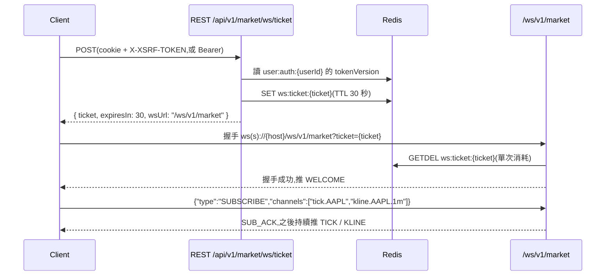

<!-- generated-by: gsd-doc-writer -->
# API 參考(索引)

> 本頁是**索引與摘要**:列出後端實際公開的每個端點,以及所有端點共用的規則(信封、錯誤碼、分頁、冪等、CSRF、限流、WebSocket ticket)。
> **規範性內容以下列契約為準**,本頁與它們有出入時,以契約和程式碼為準:
>
> - [`ai-docs/browser-auth-contract.md`](../../ai-docs/browser-auth-contract.md):cookie / CSRF / refresh / bearer / `MeResponse` / 使用者偏好
> - [`ai-docs/trading-portfolio-contract.md`](../../ai-docs/trading-portfolio-contract.md):交易、持倉、摘要、現金、股利、股數調整、活動列表,以及序列化格式
> - [`ai-docs/watchlist-contract.md`](../../ai-docs/watchlist-contract.md):觀察清單
> - [`ai-docs/security.md`](../../ai-docs/security.md):公開端點清單、權限模型、WebSocket 安全(§9、§18)、限流(§15)
>
> DTO 欄位表一律放在上述契約裡,本頁不重抄。

## 基本資訊

| 項目 | 值 |
|------|----|
| REST 前綴 | `/api/v1/**`;管理端 `/api/admin/**` |
| WebSocket | `/ws/v1/market`(需先換 ticket,見 [WebSocket ticket 流程](#websocket-ticket-流程)) |
| 本機預設 port | API `11180`、Actuator(management port)`11181`;細節見 [`docs/configuration/overview.md`](../configuration/overview.md) |
| 回應格式 | 一律 `ApiResponse<T>` JSON 信封 |
| 追蹤 id | `meta.traceId`;同一值也放在 response header `X-Trace-Id`(CORS 已 expose) |
| OpenAPI / Swagger UI | `/v3/api-docs/**`、`/swagger-ui/**` 在 URL 層放行,但**預設關閉**(`STOCK_OPENAPI_ENABLED` / `STOCK_SWAGGER_UI_ENABLED` 預設 `false`) |

部署環境的對外 base URL 不在 repo 內定義。<!-- VERIFY: 正式 / 展示環境的對外 API base URL 與 WebSocket host -->

## 認證

後端同時支援兩種傳輸方式,由 `SecurityConfig.JwtAuthenticationFilter` 判斷:

| 模式 | 適用 | 憑證怎麼帶 | CSRF |
|------|------|-----------|------|
| **瀏覽器 cookie** | Vue 前端 | `POST /api/v1/auth/login`(或 register)設定 HttpOnly cookie `stock_access`、`stock_refresh`;之後請求一律 `credentials: "include"` | unsafe 方法必須雙提交,見 [CSRF](#csrf) |
| **Bearer** | 非瀏覽器 client(腳本、整合測試、工具) | `POST /api/v1/auth/token` 取得 `data.accessToken` / `data.refreshToken`,之後帶 `Authorization: Bearer <accessToken>` | 豁免 |

重點規則(詳見 [browser-auth-contract.md](../../ai-docs/browser-auth-contract.md)):

- 同一請求若同時有 `Authorization: Bearer` 與 cookie,**以 Bearer 為準**。
- 瀏覽器端的 register / login / refresh 回應**永遠不含** token 本體,只回使用者與到期時間;前端不得把 token 放進任何 JavaScript 可讀的位置。
- Access token 為 ES256 JWT,預設 TTL 15 分鐘;refresh token 預設 14 天,每次 refresh 都會輪替。Cookie 屬性見契約〈[Auth Cookies](../../ai-docs/browser-auth-contract.md#auth-cookies)〉。
- JWT 是 stateful 的:每次請求都會比對 Redis `user:auth:{userId}` 的 `tokenVersion` 與帳號狀態。Redis 不可用時 fail-closed,回 503 `AUTH_REDIS_UNAVAILABLE`。
- `POST /api/v1/auth/logout` 會遞增 `tokenVersion`,**所有裝置**一起登出(契約〈[Refresh And Logout](../../ai-docs/browser-auth-contract.md#refresh-and-logout)〉)。Bearer 模式的 logout 需帶 access token,body 為 `{"refreshToken": "..."}`。
- 帶失效 access cookie 打 `register` / `login` / `token` / `csrf` / `GET /assets` 時,後端會略過該 cookie 而不是回 401,避免使用者卡在無法重新登入。

### 授權模型

授權分兩層(security.md §1):URL 層(`SecurityConfig`)與方法層(`@PreAuthorize`)。角色與細粒度權限定義在 `stock-common` 的 `Role` / `Permission` enum:

| 角色 | 具備的權限 |
|------|-----------|
| `USER` | `WATCHLIST_MANAGE`、`TRADE_EXECUTE`、`PORTFOLIO_VIEW`、`PROFILE_EDIT` |
| `ADMIN` | 全部權限(另含 `ASSET_ADMIN`)與 `ROLE_ADMIN` |

缺權限回 403 `AUTH_FORBIDDEN`。資料擁有權不靠權限判斷,而是以登入者 userId 限定查詢範圍;他人的資源一律當作不存在(例如觀察清單回 404 `WATCHLIST_NOT_FOUND`)。

## 端點總覽

「認證」欄:**公開** = URL 層 `permitAll`;**登入** = 只要求已認證;其餘為所需 `Permission` 或角色。「CSRF」欄只對瀏覽器 cookie 模式有意義。「冪等鍵」欄見 [冪等](#冪等idempotency-key)。

### Auth 與使用者(`stock-module-user`)

| Method | Path | 用途 | 認證 | CSRF | 冪等鍵 | 契約 |
|--------|------|------|------|------|--------|------|
| `POST` | `/api/v1/auth/register` | 註冊並設定 auth cookie | 公開(限流 5/小時/IP) | 註 1 | — | [Browser Endpoints](../../ai-docs/browser-auth-contract.md#browser-endpoints) |
| `POST` | `/api/v1/auth/login` | 瀏覽器登入,設定 auth cookie | 公開(限流 10/分/IP) | 註 1 | — | [Browser Endpoints](../../ai-docs/browser-auth-contract.md#browser-endpoints) |
| `POST` | `/api/v1/auth/token` | 非瀏覽器登入,回傳 bearer token | 公開(與 login 共用限流桶) | 不適用 | — | [Bearer Token Endpoint](../../ai-docs/browser-auth-contract.md#bearer-token-endpoint) |
| `POST` | `/api/v1/auth/refresh` | 輪替 refresh token,重設 cookie | 公開(讀 `stock_refresh` cookie;限流 5/分) | 必須 | — | [Refresh And Logout](../../ai-docs/browser-auth-contract.md#refresh-and-logout) |
| `POST` | `/api/v1/auth/logout` | 全裝置登出,清除 cookie | 公開(cookie 模式讀 `stock_refresh`;bearer 模式需 access token) | cookie 模式必須 | — | [Refresh And Logout](../../ai-docs/browser-auth-contract.md#refresh-and-logout) |
| `GET` | `/api/v1/csrf` | 設定可讀的 `XSRF-TOKEN` cookie,回傳 cookie / header 名稱 | 公開 | — | — | [CSRF](../../ai-docs/browser-auth-contract.md#csrf) |
| `GET` | `/api/v1/me` | 取得目前使用者(`MeResponse`) | 登入 | — | — | [Current User](../../ai-docs/browser-auth-contract.md#current-user-meresponse) |
| `PATCH` | `/api/v1/me/preferences` | 修改基準幣 `baseCurrency` | `PROFILE_EDIT` | 必須 | 不需要 | [User Preferences](../../ai-docs/browser-auth-contract.md#user-preferences) |
| `POST` | `/api/admin/users/{uuid}/unlock` | 解除登入失敗鎖定 | `ADMIN`(URL 層 + 方法層) | 必須 | — | security.md §15〈Account Lockout〉 |

註 1:register / login 本身不要求 CSRF;只有在瀏覽器已帶著**有效**的 `stock_access` cookie 時,該請求會被視為 cookie 已認證而要求 CSRF。前端對所有 unsafe 請求一律帶 `X-XSRF-TOKEN` 即可避開這個邊界。

### 資產與觀察清單(`stock-module-asset`)

| Method | Path | 用途 | 認證 | CSRF | 冪等鍵 | 契約 |
|--------|------|------|------|------|--------|------|
| `GET` | `/api/v1/assets?query=&page=&size=` | 資產搜尋(含報價欄位),回 `PageResponse<AssetDto>` | 公開(僅此精確路徑) | — | — | trading-portfolio-contract〈GET /api/v1/assets — 標的報價欄位〉 |
| `GET` | `/api/v1/watchlists` | 列出自己的清單(0 個時先建「我的自選」) | `WATCHLIST_MANAGE` | — | — | [watchlist-contract.md](../../ai-docs/watchlist-contract.md)〈端點〉 |
| `POST` | `/api/v1/watchlists` | 建立清單 | `WATCHLIST_MANAGE` | 必須 | 不需要 | 同上〈POST / PATCH〉 |
| `PATCH` | `/api/v1/watchlists/{id}` | 改名 | `WATCHLIST_MANAGE` | 必須 | 不需要 | 同上〈POST / PATCH〉 |
| `DELETE` | `/api/v1/watchlists/{id}` | 刪除清單 | `WATCHLIST_MANAGE` | 必須 | 不需要 | 同上〈端點〉 |
| `POST` | `/api/v1/watchlists/{id}/items` | 以 body `{symbol}` 加入項目 | `WATCHLIST_MANAGE` | 必須 | 不需要 | 同上〈POST /{id}/items〉 |
| `DELETE` | `/api/v1/watchlists/{id}/items/{assetId}` | 移除項目 | `WATCHLIST_MANAGE` | 必須 | 不需要 | 同上〈DELETE /{id}/items/{assetId}〉 |
| `PUT` | `/api/v1/watchlists/{id}/items/order` | 整份重排 | `WATCHLIST_MANAGE` | 必須 | 不需要 | 同上〈PUT /{id}/items/order〉 |

`/api/v1/assets` 的 `page` 夾限至 0..10000、`size` 夾限至 1..100(預設 `0` / `20`)。觀察清單路徑一律用 UUID,不放 symbol(FX 代號含 `/`)。

### 行情(`stock-module-market-data`)

| Method | Path | 用途 | 認證 | CSRF | 冪等鍵 | 契約 |
|--------|------|------|------|------|--------|------|
| `GET` | `/api/v1/market/{symbol}/latest` | 單一標的最新 tick(Redis 優先,miss 回落 DB) | 登入 | — | — | 程式碼(`MarketController`) |
| `GET` | `/api/v1/market/latest?symbols=` | 批次最新 tick,最多 50 檔;未知 symbol 直接略過 | 登入 | — | — | 程式碼(`MarketLatestService`) |
| `GET` | `/api/v1/market/{symbol}/klines?interval=&from=&to=&limit=` | K 線(`1m` / `5m` / `15m` / `1h` / `1d`) | 登入 | — | — | 程式碼(`MarketController`、`KlineQueryService`) |
| `POST` | `/api/v1/market/ws/ticket` | 換取 WebSocket 一次性 ticket | 登入 | 必須 | — | security.md §9 |
| `POST` | `/api/v1/market/backfill` | 觸發歷史回補 job,回 **202** | `ADMIN`(方法內 `requireAdmin`) | 必須 | 選填 | 程式碼(`BackfillController`) |
| `GET` | `/api/v1/market/backfill/{jobExecutionId}` | 查詢回補 job 狀態 | `ADMIN`(方法內 `requireAdmin`) | — | — | 程式碼(`BackfillController`) |

行情端點細節:

- `symbol` 大小寫敏感,必須與資產主檔代號完全一致。查無資產或尚無 tick → 404 `ASSET_NOT_FOUND`;批次超過 50 檔 → 400 `LATEST_BATCH_TOO_LARGE`。
- K 線:`from` 必填(含)、`to` 選填(不含,預設現在);`limit` 預設 500、上限 5000。`from` / `to` 接受與 `GET /api/v1/trades` 相同的三種時間格式(帶偏移量、不帶偏移量、純日期),由 `ApiTimeParser` 解析。query string 中的 `+` 請編碼成 `%2B`。interval 不合法 → 400 `KLINE_INTERVAL_INVALID`。
- K 線與最新報價的價格是一般記號的**字串**,與交易 / 持倉的金額同一格式(見 trading-portfolio-contract〈序列化格式〉)。
- Backfill:body 為 `{symbol, from, to, interval}`(`from` / `to` 為 ISO-8601 instant),範圍上限 90 天(超過 → 400 `BACKFILL_RANGE_TOO_LARGE`)。`/api/v1/market/backfill` **不在** `/api/admin/**` 之下,ADMIN 檢查在 controller 方法內,非 ADMIN 回 403 `AUTH_FORBIDDEN`。

### 交易與投資組合(`stock-module-trading`)

| Method | Path | 用途 | 認證 | CSRF | 冪等鍵 | 契約(trading-portfolio-contract 章節) |
|--------|------|------|------|------|--------|------|
| `POST` | `/api/v1/trades` | 記錄一筆**已成交**的手動交易 | `TRADE_EXECUTE` | 必須 | **必填** | 〈POST /api/v1/trades〉 |
| `GET` | `/api/v1/trades` | 交易紀錄(篩選、排序、分頁) | `PORTFOLIO_VIEW` | — | — | 〈GET /api/v1/trades〉 |
| `GET` | `/api/v1/portfolio/holdings` | 持倉(`HoldingDto[]`,只含數量 > 0) | `PORTFOLIO_VIEW` | — | — | 〈GET /api/v1/portfolio/holdings〉 |
| `GET` | `/api/v1/portfolio/summary` | 投資組合摘要(以使用者基準幣表示) | `PORTFOLIO_VIEW` | — | — | 〈GET /api/v1/portfolio/summary〉 |
| `POST` | `/api/v1/portfolio/cash-entries` | 記一筆入金 / 出金(或沖銷) | `TRADE_EXECUTE` | 必須 | **必填** | 〈POST /api/v1/portfolio/cash-entries〉 |
| `GET` | `/api/v1/portfolio/cash-entries` | 入出金紀錄 | `PORTFOLIO_VIEW` | — | — | 〈GET /api/v1/portfolio/cash-entries〉 |
| `POST` | `/api/v1/portfolio/dividends` | 記一筆現金股利(或沖銷) | `TRADE_EXECUTE` | 必須 | **必填** | 〈POST /api/v1/portfolio/dividends〉 |
| `POST` | `/api/v1/portfolio/share-adjustments` | 記一筆配股 / 拆股 / 合股(或沖銷) | `TRADE_EXECUTE` | 必須 | **必填** | 〈POST /api/v1/portfolio/share-adjustments〉 |
| `GET` | `/api/v1/portfolio/activities` | 交易、股利、股數調整的統一活動列表 | `PORTFOLIO_VIEW` | — | — | 〈GET /api/v1/portfolio/activities〉 |

> **交易語義**:`POST /api/v1/trades` 是已成交的手動紀錄,不是委託單。沒有 pending、取消、有效期或撮合。
> 現金、股利、股數調整都是 **append-only** 帳本,不能修改或刪除,更正只能沖銷(body 帶 `reversalOfId`)。

### 回測(`stock-module-backtest`)

| Method | Path | 用途 | 認證 | CSRF | 冪等鍵 | 契約 |
|--------|------|------|------|------|--------|------|
| `POST` | `/api/v1/backtests/runs` | 建立一次回測 | 登入 | 必須 | — | 程式碼(`CreateBacktestRunRequest`、`BacktestRunDto`) |
| `POST` | `/api/v1/backtests/strategies/validate` | 驗證策略內容 | 登入 | 必須 | — | 程式碼(`ValidateStrategyRequest`、`StrategyValidationDto`) |
| `GET` | `/api/v1/backtests/runs/{runId}` | 讀取單次回測 | 登入 | — | — | 程式碼(`BacktestRunDto`) |
| `GET` | `/api/v1/backtests/runs/{runId}/result` | 讀取回測結果(未完成 → 409 `BACKTEST_RESULT_NOT_READY`) | 登入 | — | — | 程式碼(`BacktestResultDto`) |
| `GET` | `/api/v1/backtests/runs?symbol=&page=&size=` | 列出自己的回測,回 `PageResponse<BacktestRunDto>` | 登入 | — | — | 程式碼(`BacktestController`) |

後端 `ai-docs/` 目前沒有回測專屬契約。DTO 定義在 `stock-module-backtest/src/main/java/dowob/xyz/stockwebv2/backtest/api/`;前端 repo 根(路徑見 [`ai-docs/judgment.md`](../../ai-docs/judgment.md) §8)的 `docs/api-contracts/mock-to-real-contract.md` 另有回測端點規格,與程式衝突時以後端程式碼為準。回測的 run / result 以登入者 userId 查詢,`page` / `size` 不是數字時回 400 `VALIDATION_FAILED`。

### 非公開端點

`stock-start` 的 `TestOnlyController`(`/test-only/error/*`)只在 `test` profile 註冊,用來測試錯誤信封,不屬於對外 API。Actuator 走獨立的 management port,只有 `/actuator/health` 公開(security.md §17)。

## 請求與回應格式

### `ApiResponse<T>` 信封

定義在 `stock-common` 的 `dowob.xyz.stockwebv2.common.api` 套件。所有 REST 回應(包含 Spring Security 層的 401 / 403 與全域例外處理)都使用這個信封:

```json
{
  "success": true,
  "data": { "...": "..." },
  "error": null,
  "meta": {
    "traceId": "…",
    "timestamp": "2026-11-07T10:00:00+08:00"
  }
}
```

失敗時:

```json
{
  "success": false,
  "data": null,
  "error": {
    "code": "VALIDATION_FAILED",
    "message": "Validation failed",
    "fields": { "Idempotency-Key": "…" }
  },
  "meta": { "traceId": "…", "timestamp": "…" }
}
```

| 欄位 | 說明 |
|------|------|
| `success` | `true` 時 `error` 必為 `null`;`false` 時 `error` 必不為 `null`(record 建構時強制) |
| `data` | 成功的資料;沒有資料的操作(logout、admin unlock)以 `ApiResponse.empty` 回一個 `EmptyResponse` 佔位值,client 不應依賴其內容;`DELETE /api/v1/watchlists/{id}` 回 `ApiResponse<Void>` |
| `error.code` | `ErrorCode` enum 常數名(見 [錯誤碼](#錯誤碼)) |
| `error.message` | 英文訊息,預設取 `ErrorCode` 的 default message,業務例外可能帶更具體的訊息;前端應依 `code` 分派文案,不要解析 `message` |
| `error.fields` | 欄位層錯誤的 key → 訊息;沒有欄位錯誤時為 `{}`。缺少必填 header 時 key 是 header 名稱(例如 `Idempotency-Key`) |
| `meta.traceId` | 追蹤 id,**只在這裡**;不要找 `requestId` 之類的頂層欄位 |
| `meta.timestamp` | 回應產生時間(`OffsetDateTime`) |

### 序列化慣例

摘要如下,完整規則見 trading-portfolio-contract〈序列化格式〉:

- 所有 API 的 `BigDecimal` 欄位(交易 / 持倉 / 現金 / 股利 / 股數調整 / 配置 / 資產 / 行情 / 回測的金額、數量與比率)**一律是 JSON 字串**:一般記號(不會出現 `0E-8`)、保留 scale(例 `"100.00000000"`),`null` 維持 `null`。計數與整數比例(`holdingCount`、`ratioNew` 等)維持 number。
- 請求端的金額也**必須送字串**(例 `"quantity":"10"`);後端仍接受 JSON number,屬相容行為不是契約。選填金額(`fee`、`withholdingTax`)不提供時送 `null` 或省略,不要送 `""`。
- WebSocket tick / kline 推播的價格與量同樣是一般記號字串。
- 時間是帶偏移量的 ISO-8601 字串(伺服器時區 `Asia/Taipei`);前端不要假設偏移量。
- 對外 id 一律是字串 UUID(例外:`GET /api/v1/me` 的 `id`)。

### 分頁(`PageResponse<T>`)

列表端點的 `data` 是:

```json
{
  "items": [],
  "page": 0,
  "size": 20,
  "totalElements": 0,
  "totalPages": 0
}
```

- `page` 從 0 起算;`totalPages = ceil(totalElements / size)`。
- 使用 `PageResponse` 的端點:`GET /api/v1/assets`、`GET /api/v1/trades`、`GET /api/v1/portfolio/cash-entries`、`GET /api/v1/portfolio/activities`、`GET /api/v1/backtests/runs`。
- 預設 `page=0`、`size=20`。assets / trades / cash-entries / activities 會把 `page` 夾限到 0..10000、`size` 夾限到 1..100,超出範圍不報錯。
- `holdings`、`watchlists`、`market/latest`、`klines` 回傳的是一般陣列,不分頁。

### 冪等(`Idempotency-Key`)

| 端點 | 是否必填 | 重送相同 payload | 同鍵不同 payload |
|------|---------|-----------------|-----------------|
| `POST /api/v1/trades` | 必填 | 200,回既有那筆 | 409 `TRADE_IDEMPOTENCY_KEY_REUSED` |
| `POST /api/v1/portfolio/cash-entries` | 必填 | 200,回既有那筆 | 409 `CASH_IDEMPOTENCY_KEY_REUSED` |
| `POST /api/v1/portfolio/dividends` | 必填 | 200,回既有那筆 | 409 `DIVIDEND_IDEMPOTENCY_KEY_REUSED` |
| `POST /api/v1/portfolio/share-adjustments` | 必填 | 200,回既有那筆 | 409 `SHARE_ADJUSTMENT_IDEMPOTENCY_KEY_REUSED` |
| `POST /api/v1/market/backfill` | 選填 | 1 小時內同鍵重複觸發 → 409 `BACKFILL_ALREADY_RUNNING`(只防重複,不回既有結果) | 同左 |

- 帳本類端點的鍵:1–128 字元、不得全空白,以「使用者 + 鍵」為範圍。缺少、空白或過長 → 400 `VALIDATION_FAILED`,`error.fields['Idempotency-Key']`。
- payload 比對包含哪些欄位(例如都不含 `note`)各端點不同,請看 trading-portfolio-contract 各端點的〈Header〉小節。
- 建議做法:每次送出產生一把新鍵;網路失敗原樣重送時沿用舊鍵;使用者改過表單就換新鍵。
- 觀察清單、使用者偏好**不需要**冪等鍵(操作天然冪等)。

### CSRF

只適用於瀏覽器 cookie 模式,實作在 `SecurityConfig.BrowserCsrfFilter`(Spring 內建 CSRF 已停用):

1. 先呼叫 `GET /api/v1/csrf`,後端設定可讀的 cookie `XSRF-TOKEN`,並在 `data` 回傳 cookie 名稱與 header 名稱。
2. 之後每個 unsafe 請求(`POST` / `PUT` / `PATCH` / `DELETE`)都帶 `credentials: "include"`,並把 `XSRF-TOKEN` 的值放進 header `X-XSRF-TOKEN`。
3. 缺少或不一致 → 403 `AUTH_CSRF_TOKEN_INVALID`。

檢查會在以下情況觸發:請求是以 access cookie 認證的 unsafe 請求;或請求是 `POST /api/v1/auth/refresh` / `POST /api/v1/auth/logout` 且帶有 `stock_refresh` cookie。Bearer 請求一律豁免。完整契約見 browser-auth-contract〈[CSRF](../../ai-docs/browser-auth-contract.md#csrf)〉。

### CORS

允許的 origin 來自 `stock.cors.allowed-origins`(逗號分隔,禁止寫死 `*`),`allowCredentials=true`,方法為 `GET` / `POST` / `PUT` / `PATCH` / `DELETE` / `OPTIONS`,允許所有 request header,expose `X-Trace-Id`。WebSocket 握手的 Origin 白名單共用同一個設定。

## 錯誤碼

**唯一來源是 `stock-common/src/main/java/dowob/xyz/stockwebv2/common/error/ErrorCode.java`**:每個常數同時定義 HTTP status 與預設訊息,`error.code` 就是常數名,這些字面不會改名。新增或修改錯誤碼請改這個 enum,本表只是快照分類。

| 類別 | HTTP | 代表性 code |
|------|------|-------------|
| 通用 | 400 / 404 / 409 / 500 | `VALIDATION_FAILED`、`RESOURCE_NOT_FOUND`、`DUPLICATE_RESOURCE`、`INTERNAL_ERROR` |
| 認證 / 授權 | 401 | `AUTH_INVALID_CREDENTIALS`、`AUTH_TOKEN_EXPIRED`、`AUTH_REFRESH_TOKEN_INVALID` |
| | 403 | `AUTH_FORBIDDEN`、`AUTH_CSRF_TOKEN_INVALID` |
| | 429 | `AUTH_RATE_LIMITED`、`AUTH_ACCOUNT_LOCKED` |
| | 503 | `AUTH_REDIS_UNAVAILABLE` |
| 行情 | 400 / 404 / 409 / 502 | `ASSET_NOT_FOUND`、`KLINE_INTERVAL_INVALID`、`LATEST_BATCH_TOO_LARGE`、`BACKFILL_RANGE_TOO_LARGE`、`BACKFILL_ALREADY_RUNNING`、`BACKFILL_JOB_NOT_FOUND`、`PROVIDER_FETCH_FAILED` |
| WebSocket | 400 / 401 / 429 | `WS_TICKET_INVALID`、`WS_SUBSCRIPTION_LIMIT_EXCEEDED`、`WS_MSG_FORMAT_INVALID`、`WS_RATE_LIMIT_EXCEEDED` |
| 觀察清單 | 404 / 409 | `WATCHLIST_NOT_FOUND`、`WATCHLIST_ORDER_CONFLICT` |
| 回測 | 400 / 404 / 409 | `BACKTEST_INVALID_INITIAL_CAPITAL`、`BACKTEST_UNSUPPORTED_*`(symbol / period / strategy / data mode)、`BACKTEST_STRATEGY_COMPILE_FAILED`、`BACKTEST_RUN_NOT_FOUND`、`BACKTEST_RESULT_NOT_READY` |
| 交易 | 400 / 409 | `TRADE_UNSUPPORTED_TYPE`、`TRADE_INVALID_QUANTITY`、`TRADE_INVALID_PRICE`、`TRADE_INSUFFICIENT_HOLDING`、`TRADE_CONFLICT`、`TRADE_IDEMPOTENCY_KEY_REUSED` |
| 現金 | 404 / 409 | `CASH_IDEMPOTENCY_KEY_REUSED`、`CASH_ENTRY_NOT_FOUND`、`CASH_ENTRY_ALREADY_REVERSED`、`CASH_ENTRY_NOT_REVERSIBLE` |
| 股利 | 404 / 409 | `DIVIDEND_IDEMPOTENCY_KEY_REUSED`、`DIVIDEND_NOT_FOUND`、`DIVIDEND_ALREADY_REVERSED`、`DIVIDEND_NOT_REVERSIBLE` |
| 股數調整 | 404 / 409 | `SHARE_ADJUSTMENT_IDEMPOTENCY_KEY_REUSED`、`SHARE_ADJUSTMENT_NOT_FOUND`、`SHARE_ADJUSTMENT_ALREADY_REVERSED`、`SHARE_ADJUSTMENT_NOT_REVERSIBLE` |

各端點在什麼條件下回哪個 code、`error.fields` 用哪個 key,寫在對應契約的〈錯誤〉/〈Error Codes〉小節。前端應路由的認證類 code 見 browser-auth-contract〈[Error Codes](../../ai-docs/browser-auth-contract.md#error-codes)〉。

框架層例外由 `stock-start` 的 `GlobalExceptionHandler` 轉成同一個信封:

| 來源 | 回應 |
|------|------|
| `BusinessException` | 該 `ErrorCode` 的 status 與 code |
| Bean Validation 失敗、缺少必填 header、參數型別錯誤 | 400 `VALIDATION_FAILED`,`error.fields` 指名欄位或 header |
| JSON 無法解析 | 400 `VALIDATION_FAILED`,訊息 `Malformed request body`,無 `fields` |
| `RateLimitExceededException` | 429 `AUTH_RATE_LIMITED`,加 `Retry-After` header |
| 其他 Spring `ErrorResponse`(例如路徑不存在) | 依 status 對應:404 → `RESOURCE_NOT_FOUND`、400 → `VALIDATION_FAILED`、403 → `AUTH_FORBIDDEN`、401 → `AUTH_INVALID_CREDENTIALS`,其餘 → `INTERNAL_ERROR` |
| 未預期例外 | 500 `INTERNAL_ERROR`(不回傳內部細節) |
| 未認證 / 權限不足(Security 層) | 401 `AUTH_INVALID_CREDENTIALS` / 403 `AUTH_FORBIDDEN`;`AccessDeniedException` 會被重新拋出交給 Security 處理(security.md §7) |

## 限流

以 Redis 計數(`rl:{bucket}:{identity}`),由 infrastructure 的 `RateLimitService` 執行;門檻是 `stock.security.rate-limit.*`(`RateLimitProperties`)。超過一律回 429 `AUTH_RATE_LIMITED` 並帶 `Retry-After`。下表為預設值(security.md §15):

| 範圍 | 預設門檻 | 計數鍵 | 套用位置 |
|------|---------|--------|---------|
| `POST /api/v1/auth/login`、`POST /api/v1/auth/token`(共用桶) | 10 次 / 分鐘 | 來源 IP | `AuthController` |
| `POST /api/v1/auth/register` | 5 次 / 小時 | 來源 IP | `AuthController` |
| `POST /api/v1/auth/refresh` | 5 次 / 分鐘 | refresh token 擁有者(未知時用 IP) | `AuthController` |
| 其他 `/api/**`(已登入) | 100 次 / 分鐘 | userId | `ApiRateLimitInterceptor` |
| 其他 `/api/**`(未登入) | 60 次 / 分鐘 | 來源 IP | `ApiRateLimitInterceptor` |

- `ApiRateLimitInterceptor` 註冊在 `/api/**`,排除 `/api/v1/auth/**`(認證端點只套用上面的專屬門檻)。
- 帳號鎖定:連續 5 次登入失敗鎖 15 分鐘,期間回 429 `AUTH_ACCOUNT_LOCKED`;ADMIN 可用 `POST /api/admin/users/{uuid}/unlock` 解鎖。
- 來源 IP 由 `ClientIpResolver` 解析,在 ingress 後方依 `server.forward-headers-strategy` 取原始客戶端 IP。
- 實際環境若覆寫了門檻,以該環境設定為準。<!-- VERIFY: 正式 / 展示環境是否覆寫 stock.security.rate-limit.* 預設值 -->

## WebSocket ticket 流程

瀏覽器原生 `WebSocket` 不能帶自訂 header,而 JWT 不能出現在 URL,所以改用一次性 ticket。規範性細節(驗證順序、訊息格式、close code、上限)在 security.md §9 與 §18。



1. **取 ticket**:`POST /api/v1/market/ws/ticket`,需已登入;瀏覽器模式要帶 CSRF header。Redis 讀不到認證狀態時回 503 `AUTH_REDIS_UNAVAILABLE`,不會簽發一張必定被拒的 ticket。回應不含任何 access / refresh token。
2. **連線**:在 30 秒內用 `wsUrl` 加上 `?ticket=` 連線。URL 層對 `/ws/v1/market/**` 是 `permitAll`,驗證全部在 `MarketHandshakeInterceptor`。
3. **握手失敗**:缺 ticket、ticket 已用過或已過期、`tokenVersion` 不符 → HTTP 401;全域連線上限(1000)→ 503;同一 IP 超過 5 條連線 → 429。
4. **連線後**:訂閱 channel `tick.{symbol}` 或 `kline.{symbol}.{interval}`(interval 為 `1m` / `5m` / `15m` / `1h` / `1d`)。每條連線 tick 最多 100 個、kline 最多 10 個,超過的會列在 `SUB_ACK.rejected`。伺服器每 30 秒送 `PING`,client 要回 `PONG`。
5. **連線期間的驗證**:每 5 分鐘重新比對 `tokenVersion` 與帳號狀態;失效時先推 `auth_expired` 再以 4001 關閉。同一帳號最多 2 條連線,較舊的連線會被以 4002 取代。

訂閱時不會推快照,初始值請用 REST(`/api/v1/market/{symbol}/latest`、`/klines`)取得。完整的訊息形狀與 close code 表見 security.md §9〈Message Format〉、〈Custom WebSocket Close Status Codes〉。
