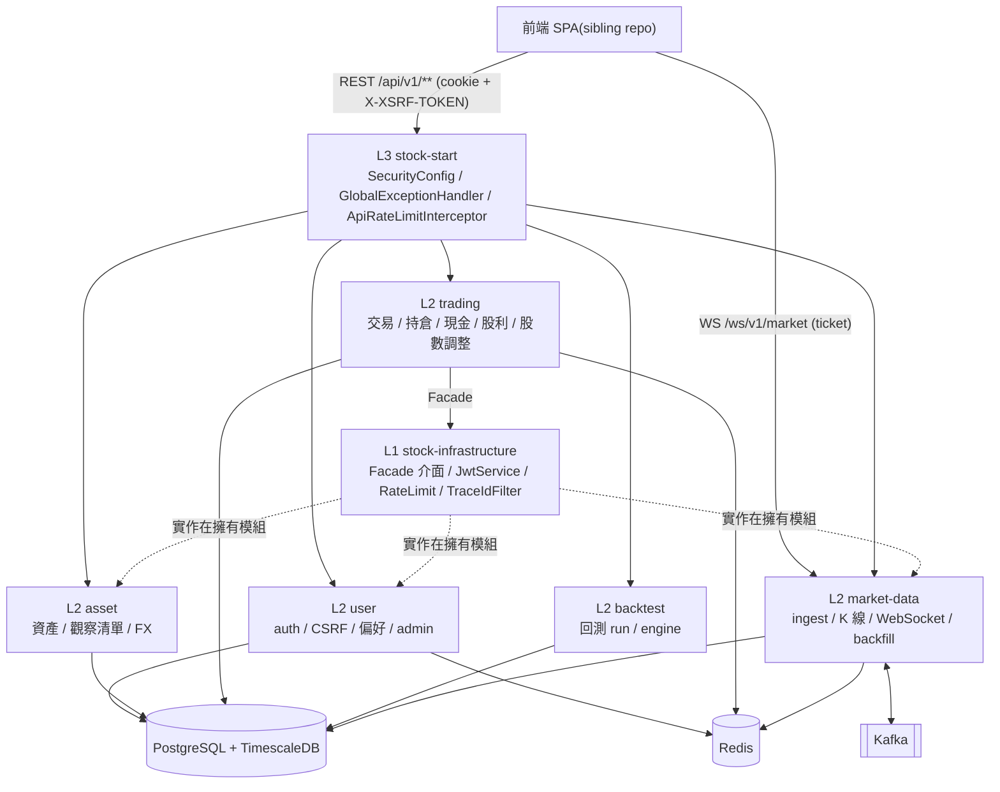

<!-- generated-by: gsd-doc-writer -->
# 架構總覽

> 本頁是給讀者的導覽,幫你快速理解後端怎麼拆、請求怎麼走。**規範性規則以 [`ai-docs/architecture.md`](../../ai-docs/architecture.md) 為準**;本頁與它有出入時,以它和程式碼為準。事件、Redis、Flyway 的細則分別在 [`ai-docs/event-conventions.md`](../../ai-docs/event-conventions.md)、[`ai-docs/redis-convention.md`](../../ai-docs/redis-convention.md)、[`ai-docs/flyway-convention.md`](../../ai-docs/flyway-convention.md)。

## 系統概述

Stock Web V2 的後端是 Java 21 / Spring Boot 4(`spring-boot-starter-parent` 4.0.4)的多模組 Maven **modular monolith**:多個業務模組有明確邊界,但只打包成一個可執行應用(`stock-start`)。它對外提供兩種介面:REST API(`/api/v1/**`,管理端 `/api/admin/**`,一律回傳 `ApiResponse<T>` 信封),以及即時行情 WebSocket(`/ws/v1/market`)。主要使用者是放在另一個 sibling repo 的 Vue 3 前端(兩邊路徑對照見 [`ai-docs/judgment.md`](../../ai-docs/judgment.md) §8)。資料存在 PostgreSQL + TimescaleDB;熱資料快取與 token 狀態放 Redis;行情資料透過 Kafka 扇出,一路寫進資料庫、一路推給 WebSocket。

架構風格:

- **分層**:L0(共用型別、schema)→ L1(Facade 介面與橫切設施)→ L2(業務模組)→ L3(組裝啟動)。
- **跨模組通訊有兩條通道**:同步走 Facade 介面,非同步走 Kafka(目前只用在行情資料)。
- **DDD-Lite,實際寫法是 transaction script**:domain 物件是沒有行為的不可變 `record`,業務規則寫在純 calculator 和 application service 裡。

## 元件圖



L0 模組(`stock-common`、`stock-db-migration`)每個模組都會依賴,圖上省略。L2 模組之間沒有 Maven 依賴,唯一合法的跨模組路徑是 L1 的 Facade 介面,實作放在擁有資料的模組裡(例如 trading 透過 `AssetFacade` 取資產幣別,透過 `MarketDataFacade` 取價格)。

## 模組邊界

| 層 | 模組 | 職責 |
|----|------|------|
| L0 | `stock-common` | `ApiResponse<T>` / `PageResponse<T>` 信封、`ErrorCode` / `BusinessException`、共用 enum、`PriceTickEvent` |
| L0 | `stock-db-migration` | 集中管理全部 Flyway migration(`V1__foundation_schema.sql` … `V19__assets_currency_check.sql`) |
| L1 | `stock-infrastructure` | Facade 介面(`AssetFacade`、`FxRateFacade`、`MarketDataFacade`、`UserPreferenceFacade`)、`JwtService`(ES256)、`RateLimitService`、`TraceIdFilter`、`ApiMetaFactory`、`AuditLogger`、Redis 設定 |
| L2 | `stock-module-user` | 註冊 / 登入 / refresh rotation / 登出、browser cookie 與 CSRF bootstrap、使用者偏好、admin 解鎖 |
| L2 | `stock-module-asset` | 資產查詢(`ILIKE` 搜尋)、觀察清單、FX 匯率;`AssetFacadeImpl`、`FxRateFacadeImpl` |
| L2 | `stock-module-trading` | 已成交交易紀錄、持倉、portfolio summary、現金帳、現金股利、股數調整、活動紀錄 |
| L2 | `stock-module-backtest` | 回測 run 管理、策略驗證、`DeterministicBacktestEngine` |
| L2 | `stock-module-market-data` | 行情 ingest、Kafka consumer、K 線查詢、WebSocket ticket 與推播、Spring Batch 歷史回補;`MarketDataFacadeImpl` |
| L3 | `stock-start` | `StockWebV2Application` 入口、`SecurityConfig`、`GlobalExceptionHandler`、API rate limit interceptor、整合測試 |

邊界由 `stock-start/src/test/java/dowob/xyz/stockwebv2/start/ArchitectureRulesTest.java`(ArchUnit)守護,目前有 4 條規則:

1. L2 模組(`user|asset|trading|backtest|marketdata`)彼此不得相依。
2. `*Facade` 介面必須放在 `dowob.xyz.stockwebv2.infrastructure..`。
3. `@RestController` 不得直接依賴 repository。
4. `@RestController` 不得直接依賴 Facade,只能由 application service 呼叫。

每個 L2 模組內部的套件都是 `dowob.xyz.stockwebv2.<module>.{api,service,domain,repository}`。market-data 另外有 `batch`、`config`、`consumer`、`ingest`、`observability`、`persistence`、`provider`、`ws`,backtest 另外有 `engine`。

## 資料流

### 一般 REST 請求(以新增交易為例)

1. 前端對 unsafe method 先打 `GET /api/v1/csrf` 取得 `XSRF-TOKEN` cookie,之後的請求帶 HttpOnly access cookie,並把同一個值放進 `X-XSRF-TOKEN` header。完整契約見 [`ai-docs/browser-auth-contract.md`](../../ai-docs/browser-auth-contract.md)。
2. `TraceIdFilter` 讀取或產生 trace id(`X-Trace-Id`)並寫進 MDC。這個 id 之後會放在回應的 `meta.traceId`。
3. `SecurityConfig` 的 filter chain:
   - `JwtAuthenticationFilter` 從 `Authorization` header 或 access cookie 取出 JWT,用 `JwtService` 驗證,並比對 Redis `user:auth:{userId}` 裡的 token version(stateful JWT,session 為 `STATELESS`)。
   - `BrowserCsrfFilter` 只對「用 cookie 認證的 unsafe 請求」和「refresh / logout 這類 browser session 動作」做 double-submit 比對,也就是 cookie 和 header 的值必須相同。Spring 內建的 CSRF 已關閉。
   - 路徑授權:登入相關、`GET /api/v1/assets`、`GET /api/v1/csrf`、`/actuator/health`、OpenAPI 文件可匿名存取;`/api/admin/**` 需要 `ADMIN`;其他一律要認證。
4. `ApiRateLimitInterceptor`(以 Redis `rl:*` 計數)套用 rate limit。
5. `TradingController` → `TradingService`(經 `AssetFacade` 取資產資訊)→ `TradePayloadMatcher` / `HoldingCalculator` → `JdbcTradingRepository`。
   - `transactions` 表是 append-only,由 DB trigger 強制(`V8__transactions_append_only_trigger.sql`)。
   - `holdings` 用 `SELECT … FOR UPDATE` 加上 SQL 內的 `version` 檢查處理並發。
   - 交易建立用 `Idempotency-Key` 確保冪等。
   - commit 之後清除 Redis 裡的 portfolio 快取(`PortfolioCache`)。
6. 回傳 `ApiResponse<T>`;失敗時由 `GlobalExceptionHandler`(security 錯誤則由 `ApiSecurityErrorWriter`)轉成同一個信封格式。

注意:`POST /api/v1/trades` 記錄的是**已成交**的交易,不是委託單。交易與持倉語義見 [`ai-docs/trading-portfolio-contract.md`](../../ai-docs/trading-portfolio-contract.md)。

### 讀取路徑與快取

- Portfolio 估值是**讀取時才計算**:`holdings` 加上 `MarketDataFacade` 提供的最新價格,結果快取在 Redis `portfolio:valuation:*` / `portfolio:summary:*`(TTL 60 秒)。資料庫仍然是 source of truth,沒有每日回寫的 batch。
- 最新價格:先讀 Redis `market:latest:{assetId}`,沒有再回退到 `market_prices`。
- Redis key 的命名與 TTL 一律以 [`ai-docs/redis-convention.md`](../../ai-docs/redis-convention.md) 的「As Implemented」表為準。

### 行情 ingest 與 WebSocket 推播

```
DataProvider(可插拔;目前為 MockDataProvider)── ScheduledIngestor
        │  MarketDataIngestService.publishTick
        ▼
Kafka  market.price.tick.v1  (key = assetId)
        ├─► PriceWriterConsumer ──► market_prices(TimescaleDB hypertable)
        │                              └─► kline_1m / 5m / 15m / 1h / 1d(continuous aggregates)
        └─► WsBroadcastConsumer ──► Redis market:latest:{assetId}(TTL 5 分鐘)
                                  └─► WebSocket 推送(TICK + KLINE)
```

- 前端連線前先打 `POST /api/v1/market/ws/ticket` 取得一次性 ticket(Redis `ws:ticket:*`,TTL 30 秒),再連 `/ws/v1/market`。HTTP security 層對這個路徑放行,改由 `MarketHandshakeInterceptor` 驗證 ticket,不允許匿名連線。
- WebSocket 用原生 `TextWebSocketHandler`(`MarketWebSocketHandler`,沒有 STOMP)。`SubscriptionManager` 管理多工訂閱;`SessionSendDispatcher` 為每個 session 維護獨立的送出佇列,避免慢的 client 拖累其他人。
- 歷史回補:`POST /api/v1/market/backfill` → Spring Batch(`BackfillJobConfig`)→ Kafka `market.price.backfill.v1` → `market_prices`。
- market-data 可以分項關閉(`market-data.ingestor.enabled`、`market-data.scheduling.enabled`),但**不能獨立部署**。

Kafka topic、consumer group、retention 與 DLT 的規則見 [`ai-docs/event-conventions.md`](../../ai-docs/event-conventions.md)。目前**沒有**跨模組的 domain event:`EventPublisher` / `DomainEvent` 只保留為擴充點,沒有實作,交易也不會發事件。

## 關鍵抽象

| 抽象 | 位置 | 說明 |
|------|------|------|
| `ApiResponse<T>` / `PageResponse<T>` | `stock-common/src/main/java/dowob/xyz/stockwebv2/common/api/` | 統一回應信封 `{success, data, error, meta}`;trace id 只放在 `meta.traceId` |
| `ErrorCode` / `BusinessException` | `stock-common/src/main/java/dowob/xyz/stockwebv2/common/error/` | 業務錯誤碼與例外,由 `GlobalExceptionHandler` 轉成信封 |
| `MarketDataFacade` | `stock-infrastructure/src/main/java/dowob/xyz/stockwebv2/infrastructure/marketdata/` | 其他模組取得最新價格 / 日行情的唯一入口 |
| `AssetFacade` / `FxRateFacade` | `stock-infrastructure/src/main/java/dowob/xyz/stockwebv2/infrastructure/{asset,fx}/` | 資產 metadata 與匯率的跨模組查詢 |
| `UserPreferenceFacade` | `stock-infrastructure/src/main/java/dowob/xyz/stockwebv2/infrastructure/user/` | 使用者偏好(例如 base currency)的跨模組查詢 |
| `JwtService` | `stock-infrastructure/src/main/java/dowob/xyz/stockwebv2/infrastructure/security/` | ES256 JWT 簽發與驗證 |
| `SecurityConfig` | `stock-start/src/main/java/dowob/xyz/stockwebv2/start/config/` | filter chain、路徑授權、CORS;JWT filter 與 CSRF filter 目前是它的 inner class |
| `DataProvider` / `ProviderRegistry` | `stock-module-market-data/src/main/java/dowob/xyz/stockwebv2/marketdata/provider/` | 可插拔的行情來源(Strategy) |
| `HoldingCalculator` | `stock-module-trading/src/main/java/dowob/xyz/stockwebv2/trading/domain/` | 計算持倉的純函式規則 |
| `DeterministicBacktestEngine` | `stock-module-backtest/src/main/java/dowob/xyz/stockwebv2/backtest/engine/` | 決定性回測引擎 |

## 資料存取與持久化

- 不用 JPA。repository 以介面加上 `Jdbc*Repository` 實作的方式撰寫,主要使用 Spring `JdbcClient` 寫明確的 SQL;market-data 的批次寫入用 `NamedParameterJdbcTemplate#batchUpdate`。Aggregate 邊界的規則(跨 aggregate 只用 ID 參照、每個 aggregate 只有一個 repository)見 [`ai-docs/architecture.md`](../../ai-docs/architecture.md) §Aggregate Root Boundaries。
- 對外 ID 一律是 UUID;內部的跨 aggregate 參照用 `Long` ID。
- 以下 ledger 都是 append-only,由 DB trigger 禁止 UPDATE / DELETE,沖銷一律以新增一筆的方式記錄:
  - `transactions`(V8)
  - `cash_ledger_entries`(V15)
  - `cash_dividends`(V16)
  - `share_adjustments`(V17)
- Schema 只能透過 `stock-db-migration` 變更。版號連續、已套用的 migration 不能修改,下一個版號是 V20。詳見 [`ai-docs/flyway-convention.md`](../../ai-docs/flyway-convention.md)。

## 目錄結構說明

```
stock-web-v2/
├── pom.xml                    # parent pom(Java 21、模組清單、外掛與版本)
├── mvnw, mvnw.cmd             # Maven wrapper
├── ai-docs/                   # 規範與契約(architecture、code-standards、browser-auth-contract、各領域契約)
├── docs/                      # 讀者導向文件、歷史計畫與審查紀錄
├── scripts/                   # 開發輔助腳本(run-dev.ps1、GenerateJwtJwk.java)
├── stock-common/              # L0:跨模組共用型別
├── stock-db-migration/        # L0:唯一的 schema 來源
├── stock-infrastructure/      # L1:Facade 介面與橫切設施
├── stock-module-user/         # L2:身分驗證與使用者
├── stock-module-asset/        # L2:資產、觀察清單、匯率
├── stock-module-trading/      # L2:交易與 portfolio
├── stock-module-backtest/     # L2:回測
├── stock-module-market-data/  # L2:行情與即時推播
└── stock-start/               # L3:唯一可執行應用、安全設定、整合 / 架構測試
```

這樣切分的原因:

- **L0 / L1 獨立成模組**,讓 L2 業務模組只依賴穩定的共用型別與介面,彼此之間沒有依賴。
- **schema 集中在 `stock-db-migration`**,避免多個模組爭用 Flyway 版號。
- **安全設定與整合測試放在 `stock-start`**,因為只有組裝完整的應用才能驗證整條請求鏈。
- `ArchitectureRulesTest` 也放在 `stock-start`,因為只有那裡看得到所有模組。

## 可觀測性與設定

- Actuator 對外開放 `health`、`info`、`metrics`(`management.endpoints.web.exposure.include`);market-data 另外在 `marketdata/observability/` 提供健康與指標。
- 日誌使用 SLF4J + `stock-start/src/main/resources/logback-spring.xml`;稽核紀錄由 `AuditLogger` 寫出。
- 設定檔是 `stock-start/src/main/resources/application.yaml`,另有 `dev`、`demo`、`e2e-browser` profile。外部服務位址用環境變數覆寫,例如 `STOCK_KAFKA_BOOTSTRAP_SERVERS`(預設 `localhost:9092`)、`STOCK_CORS_ALLOWED_ORIGINS`(預設 `http://localhost:5173`)、`STOCK_REDIS_DATABASE`(預設 DB 1)。
- 目標部署基礎設施是 K3s + PostgreSQL / TimescaleDB + Redis + Kafka(KRaft)。<!-- VERIFY: 實際部署環境(K3s 叢集、各服務規格)無法由 repo 內容驗證 -->

## 延伸閱讀

- [`ai-docs/architecture.md`](../../ai-docs/architecture.md):規範性架構規則(Facade 規則、aggregate 邊界、關鍵設計決策)
- [`ai-docs/code-standards.md`](../../ai-docs/code-standards.md):程式規範(包含 Facade 呼叫次數上限)
- [`ai-docs/browser-auth-contract.md`](../../ai-docs/browser-auth-contract.md):browser cookie auth 與 CSRF 契約
- [`ai-docs/security.md`](../../ai-docs/security.md):安全規範
- [`ai-docs/event-conventions.md`](../../ai-docs/event-conventions.md):Kafka 與事件
- [`ai-docs/redis-convention.md`](../../ai-docs/redis-convention.md):Redis key 與 TTL
- [`ai-docs/flyway-convention.md`](../../ai-docs/flyway-convention.md):migration 規則
